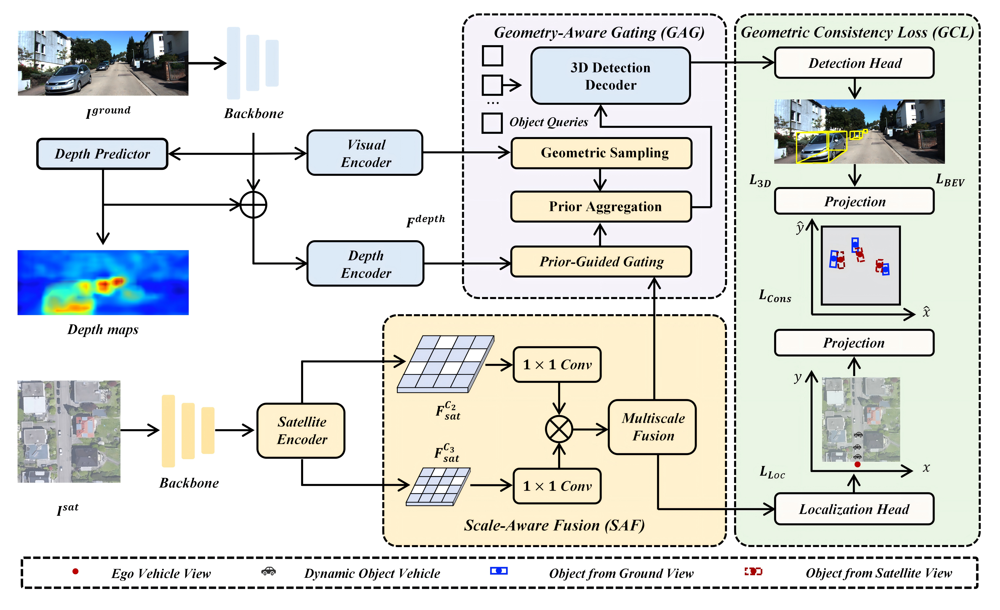

<div align="center">
<h1>Satellite-Assisted Monocular 3-D Object Detection for the Internet of Vehicles</h1>

<a href="LICENSE"></a>
<a href="https://github.com/ShengTaowei/XVDETR-3D-Dynamic-Object-Detection"></a>


**Aerospace Information Research Institute, Chinese Academy of Sciences &nbsp;|&nbsp; University of Chinese Academy of Sciences**
</div>

---


## Table of Contents

- [Overview](#overview)
- [Main results](#main-results)
- [1. Environment setup](#1-environment-setup)
- [2. Dataset preparation](#2-dataset-preparation)
- [3. Training and evaluation](#3-training-and-evaluation)
- [4. Reproducing the paper tables](#4-reproducing-the-paper-tables)
- [5. Communication and compute measurement](#5-communication-and-compute-measurement)
- [Model Zoo](#model-zoo)
- [License and acknowledgements](#license-and-acknowledgements)
- [Citation](#citation)

---

## Overview

XVDETR is a **vehicle–satellite collaborative** monocular 3-D detector. Instead of
exchanging perception data with roadside units frame by frame, it consumes a
**prefetched, cached, asynchronously acquired satellite tile** as a reusable
static-scene prior, and keeps the ground-view detector as the primary prediction
pathway.

<p align="center">
  
</p>


## Main results

**KITTI val**, Car, `AP|R40`, IoU = 0.7:

| Method | Extra data | AP3D E / M / H | APBEV E / M / H |
|:---|:---|:---|:---|
| MonoDETR (ICCV23) | None | 28.84 / 20.61 / 16.38 | 37.86 / 26.95 / 22.80 |
| MonoDGP (CVPR25) | None | 30.76 / 22.34 / 19.02 | 39.40 / 28.20 / 24.42 |
| MonoCoP (CVPR26, baseline) | None | 32.06 / 23.98 / 20.64 | 42.20 / 31.29 / 27.58 |
| **XVDETR (ours)** | **Satellite** | **34.75 / 24.85 / 21.20** | **44.72 / 32.30 / 28.18** |

**nuScenes val** (KITTI-style conversion, front camera), Car:

| Method | AP3D@0.5 E / M | APBEV@0.5 E / M | AP3D@0.7 E / M | APBEV@0.7 E / M |
|:---|:---|:---|:---|:---|
| MonoCoP (baseline) | 33.70 / 30.37 | 38.01 / 33.72 | 10.34 / 8.97 | 18.00 / 15.91 |
| **XVDETR (ours)** | **36.29 / 32.14** | **39.90 / 36.39** | **12.20 / 10.64** | **20.21 / 17.96** |

---

## 1. Environment setup

Verified on Ubuntu 20.04 / 22.04 with a single NVIDIA L40S (48 GB). All reported
numbers use **one GPU, batch size 16** unless stated otherwise.

### 1.1 Base environment

```bash
git clone https://github.com/ShengTaowei/XVDETR-3D-Dynamic-Object-Detection.git
cd XVDETR-3D-Dynamic-Object-Detection

conda create -n xvdetr python=3.9 -y
conda activate xvdetr

conda install pytorch==2.4.1 torchvision==0.19.1 torchaudio==2.4.1 \
              pytorch-cuda=12.1 -c pytorch -c nvidia

pip install -r requirements.txt
```

### 1.2 Compile the deformable-attention operator

```bash
cd lib/models/monocop/ops/
bash make.sh
cd ../../../..
```

### 1.3 Extra dependencies **for dataset preparation only**

The satellite geo-referencing / cropping pipeline reads GeoTIFF tiles and writes
shapefiles, so it needs a few geospatial packages that are *not* required for
training or inference:

```bash
pip install rasterio geopandas shapely pyshp Pillow
# optional, only for the nuScenes -> KITTI conversion
pip install nuscenes-devkit
```
---

## 2. Dataset preparation


### 2.1 Crop geometry (important — read before running)

| Property | Value |
|:---|:---|
| Physical window | **80 m × 80 m** (40 m to each side, 80 m forward) |
| Ego anchor | **bottom-centre** of the crop, heading pointing **up** |
| Output size | **612 × 612 px** (derived from the tiles' native GSD, not hard-coded) |
| Nominal GSD | ≈ **0.131 m/px** (mean native resolution of the 18 source tiles) |
| Source CRS | EPSG:3857 (Web Mercator) |
| Latitude scale correction | applied: `1 m_true = (1 / cos φ) m_projected` |
| Yaw convention | `0 = East`, counter-clockwise positive (validated against velocity heading: mean offset 0.89°, std 9.85° over 6 167 frames with speed > 3 m/s) |


### 2.2 KITTI

**Step 1 — standard KITTI 3-D object data + OXTS GPS/IMU.**

```
data/KITTI/
├── ImageSets/
├── training/
│   ├── image_2/          # 000000.png ... 007480.png
│   ├── label_2/
│   ├── calib/
│   └── oxts/             # REQUIRED: per-frame lat / lon / yaw
└── testing/
    ├── image_2/
    └── calib/
```

Split follows the common protocol: **3 712 train / 3 769 val** (`data/KITTI/chen_split`).

**Step 2 — download satellite imagery.** Export large geo-referenced GeoTIFF tiles
covering the KITTI trajectories (we used Google Earth Pro, historical imagery enabled).
Place them in `image/` 

**Step 3 — crop the ego-aligned tiles.**

```bash
# 80 m forward window -> 612x612 crops (the setting used in the paper)
python tools/crop_satellite_tiles.py \
    --out_dir data/KITTI/sat_crop_fwd80 --forward_m 80

# 40 m forward window (earlier variant, kept for reference)
python tools/crop_satellite_tiles.py \
    --out_dir data/KITTI/sat_crop_fwd
```

**Step 4 — verify the alignment before training.**

```bash
python tools/visualize_sat_alignment.py
```

Always run this once: it overlays the projected 3-D box centres on the satellite crop.
A systematic offset means the tile georeferencing is off, not the code.

### 2.3 nuScenes

nuScenes ships **no GPS**, so three extra steps are needed before cropping.

```bash
# 1) nuScenes -> KITTI-style layout (token filenames -> six-digit frame ids)
python tools/convert_nuscenes_to_monocop.py \
    --raw-dataroot /data/sets/nuscenes --version v1.0-trainval \
    --output data/nuScenes_kitti_export --layout nusc

# 2) project ego poses to WGS84 and emit AOI shapefiles + frames_latlon.csv
python tools/nuscenes_satellite_regions.py \
    --dataroot /data/sets/nuscenes --version v1.0-trainval \
    --out-dir data/nuScenes/satellite_regions \
    --tile-m 600 --overlap-m 50 --margin-m 300

# 3) write the projected lat/lon back into the KITTI-style oxts records
python tools/nuscenes_patch_oxts_latlon.py

# 4) crop exactly as for KITTI
python tools/crop_satellite_tiles.py --dataset nusc \
    --forward_m 80 --out_dir data/nuScenes/sat_crop_fwd80
```

### 2.4 Expected output layout

```
data/
├── KITTI/
│   ├── training/{image_2,label_2,calib,oxts}/
│   ├── ImageSets/
│   ├── sat_crop_fwd80/         # 612x612 PNGs + crop_meta.json   <- used by the paper
│   └── sat_crop_fwd/           # 40 m variant
└── nuScenes/
    ├── training/  validation/
    ├── satellite_regions/      # AOI shapefiles + geojson + frames_latlon.csv
    └── sat_crop_fwd80/
```

Point the config at a crop directory with `dataset.sat_dir`.

---

## 3. Training and evaluation

```bash
# single GPU
bash train.sh 0 --config config/monocop_car_satgeo.yaml

# multi-GPU DDP
bash train.sh 0,1 --config config/monocop_car_satgeo.yaml

# evaluation only
python train_val.py --config config/monocop_car_satgeo.yaml \
    --pretrain_model <checkpoint.pth> -e
```


---

## Model Zoo

Released upon acceptance. Each entry will ship with a `sha256` and the exact
`AP|R40` it reproduces.

| Setting | AP3D E / M / H | Checkpoint | Training log |
|:---|:---|:---|
| KITTI Car (`monocop_car_satgeo`) | 34.75 / 24.85 / 21.20 | coming soon | |
| KITTI 3-class (Ped / Cyc) | see Table IV | coming soon | |
| nuScenes front camera | see Table VIII | coming soon | |

---

## License and acknowledgements

This project is released under the **MIT License** (inherited from the MonoCoP
codebase on which it is built). See [`LICENSE`](LICENSE).

XVDETR is built on top of **MonoCoP** (Zhang *et al.*, CVPR 2026) and reuses components
from [DEVIANT](https://github.com/abhi1kumar/DEVIANT),
[MonoDETR](https://github.com/ZrrSkywalker/MonoDETR),
[MonoDGP](https://github.com/PuFanqi23/MonoDGP),
[DETR](https://github.com/facebookresearch/detr) and
[Deformable DETR](https://github.com/fundamentalvision/Deformable-DETR).
We thank the authors for making their code publicly available.

**Satellite imagery licensing.** The satellite tiles themselves are **not**
redistributed here, because the common sources (e.g. Google Earth Pro exports) do not
permit redistribution. This repository only ships the *code* that downloads, indexes,
geo-references and crops them; every user obtains imagery under their own licence.

---

